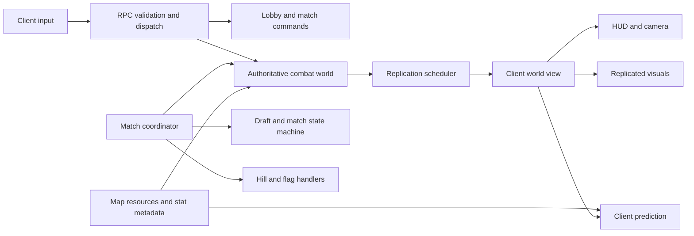

# Super Star Fighter architecture and map review

Reviewed 2026-10-22 at commit `cbc306b`, release `0.1.0-beta.19`, protocol 50, packet format 18.

**Assessment: the architecture is sound for the current game, with specific correctness and growth problems to address.** Keep the authoritative simulation, shared rules, resource-based content, and separated presentation owners. Prioritize collision correctness, objective fairness, and map-policy consistency. Further map mechanics should follow those fixes and better acceptance coverage.

This review covers runtime ownership, combat and prediction, transport and replication, match/draft/objective flow, the twelve shipped map resources, arena effects, NPC navigation, authoring validation, UI contracts, release tooling, and automated acceptance. It combines source inspection, existing tests, and targeted diagnostic experiments. It is not a human playtest, a complete adversarial security audit, or certification of every platform and network condition. Gameplay recommendations below are distinguished from reproduced defects.

## Findings in priority order

### 1. P1 — Boosted ships can cross solid cover

`src/shared/arena/arena_collision_system.gd:11` calculates the endpoint, then pushes an overlapping ship toward the nearest rectangle edge. It never checks which edge the movement entered. A fast ship can enter beyond the rectangle's midpoint and be pushed out the opposite side, even when its endpoint was still inside the wall.

Reproduced through `AuthoritativeWorld.step`, using stats derived from actual cards: three Impossible Engine stacks and one Afterburner. With an active boost at 3,960 px/s, a ship at `(1300, 659)` moving downward on Broken Orbit ends the next 60 Hz tick at `(1300, 780)`. The solid wall spans y=680–760; the ship radius is 20. The ship crosses the entire wall in one tick. The fixture starts at an attainable boosted velocity to isolate the collision step.

**Action:** use swept ship collision with sliding, including rectangle and circle contacts. A bounded substep approach is another possible implementation if its maximum travel and collision cost are explicitly enforced. Retain overlap recovery for ships that start embedded. Use the same correction in authority and client replay. Add regressions for supported boosted speeds, corners, knockback, and open/closed doors.

### 2. P1 — Neutral flag placement systematically favors one team on six maps

`src/shared/match/game_mode_rules.gd:140` searches outward from an obstructed objective location and returns the first clear sample. Every ring starts at angle zero, toward positive x. Team capture bases and team deployment keep fixed left/right identities (`authoritative_match_coordinator.gd:695`), so this is a persistent team advantage rather than an offset that alternates between heats.

Measured routes below use the production NPC route planner, including its conservative clearance and Wormhole avoidance. They measure base-center-to-flag geometry, not human travel times or win rates. The other six maps have equal route lengths in this check.

| Map | Flag position | Team 1 route, px | Team 2 route, px | Team 2 shorter by |
| --- | --- | ---: | ---: | ---: |
| Core Arena | (1960, 900) | 1,860 | 1,050 | 44% |
| Riftline | (1870, 900) | 1,680 | 1,140 | 32% |
| Switchyard | (1780, 900) | 2,027 | 1,230 | 39% |
| Solar Tide | (1870, 900) | 1,752 | 1,140 | 35% |
| Wormhole | (1960, 900) | 2,038 | 1,050 | 48% |
| Solar Crucible | (1870, 900) | 1,748 | 1,140 | 35% |

**Action:** author mode-specific objective anchors and validate equivalent team access. For symmetric maps, choose a clear location on the symmetry axis. For deliberately asymmetric layouts, validate travel cost and alternate sides. Changing the search's starting angle alone would conceal the underlying lack of a fairness criterion. Add a team-route parity check to map acceptance.

### 3. P2 — The competitive preset's promise conflicts with the mandatory map rotation

`src/shared/lobby/match_presets.gd:5` advertises no arena effects. Its implementation sets optional effects to Off. However, `src/shared/arena/arena_effect_rules.gd:18` returns intrinsic effects before checking Off, and `authoritative_match_coordinator.gd:97` always takes every registered map into the rotation. Solar Crucible still has flares and surface burns. Wormhole gravity and lethal horizons, and Solar Tide currents, are also outside the optional-effect switch.

Intrinsic map identity is a reasonable design choice. The conflict is the setup contract: the competitive preset cannot deliver the advertised rules, and the host has no map pool control. The arena-settings panel does disclose Crucible's exception, but the preset description and semi-competitive rules still promise effects are disabled.

**Action:** add an authoritative map pool to `MatchConfig`, freeze it for the match, clear readiness when it changes, and give the competitive preset an explicitly reviewed pool. Keep intrinsic hazards on maps whose identity depends on them. Update the preset wording and show the actual pool and intrinsic mechanics before players ready up. Also allow relevant intrinsic hazard-strength controls to remain usable when optional effects are Off; the current panel disables them.

### 4. P2 — Map validation checks clearance, but does not establish navigability or fairness

`src/shared/arena/map_definition.gd:29` validates finite geometry, bounds, materials, field parameters, spawn count, spawn clearance, and pairwise spacing. It does not validate exits, connected regions, spawn-to-objective access, field/spawn overlap, or sightline exposure. `ArenaLayout.validate_map` substantially repeats the clearance checks.

A diagnostic copy of Wormhole with a fully closed rectangular room around an existing spawn still returns zero validation errors. The walls lie outside its 96-pixel clearance area, so every implemented check passes although the ship cannot leave. This is an authoring-safety gap, not a claim that a shipped spawn is currently trapped.

For the shipped roster, a supplemental check found routes from all 384 spawn anchors to their neutral-flag location. That is useful evidence, but does not prove two independent exits, fair objective access, or overtime convergence in every mode/state.

The expansion plan's proposed maximum of eight exposed neighboring spawns is also far from the current geometry: the maximum visible spawn-center count ranges from 17 to 31 across the maps. Wormhole exposes all 31 other centers from at least one spawn. These counts use geometric line of sight; projectile range, facing, and gravity affect actual firing opportunities. The plan explicitly describes future requirements, so this is unfinished design acceptance rather than a newly failing shipped test.

**Action:** consolidate validation and add connectivity, two-exit, hazard-clearance, and mode-objective checks. Start with static and most restrictive door states. Cargo removal only opens space, but objective exposure after destruction still deserves evaluation. Treat sightline targets as design targets to confirm or revise with playtests.

### 5. P2 — Existing load acceptance leaves little room for more mechanics

The five mixed-workload cases all passed their functional gates. Each combines 16 simulated humans, 16 NPCs, replenished dense projectile load, world simulation, coordination, and packet encoding. Each reports 480 measured ticks after warmup.

| Case | CPU p95 | CPU p99 | Maximum | Ticks above 16.67 ms |
| --- | ---: | ---: | ---: | ---: |
| Core Arena / Death Match | 16.95 ms | 20.47 ms | 25.82 ms | 28 / 480 |
| Dead Freight / Team Death Match | 15.55 ms | 17.37 ms | 18.55 ms | 8 / 480 |
| Twin Suns / Hill | 15.94 ms | 17.84 ms | 19.84 ms | 12 / 480 |
| Switchyard / Capture the Flag | 14.92 ms | 18.31 ms | 21.93 ms | 5 / 480 |
| Prism Array / Team Capture the Flag | 16.43 ms | 17.80 ms | 23.14 ms | 20 / 480 |

These are local measurements from an overload fixture, not ordinary-match FPS. They exclude socket/RPC transport, rendering, and fixture refill. Map and mode vary together, so this table cannot isolate relative map cost. The default matrix deliberately gates functional validity, not strict tick-budget compliance. All cases would fail its optional zero-overrun check on this run.

World simulation dominates the measured cost: its per-phase p95 is roughly 11.9–13.6 ms. That makes projectile/collision profiling the next useful performance investigation. Coordinator cost was small in these cases.

The matrix hardcodes five maps and omits Solar Tide, Wormhole, and Solar Crucible (`src/test/architecture_matrix_verifier.gd:15`). Unit coverage does include the newer maps; the combined stress coverage does not.

**Action:** add representative gravity/hazard stress cases and a named-hardware performance lane, keeping correctness acceptance separate from timing. Profile before selecting an optimization. Repeat real-client impaired-network acceptance for meaningful changes to replication or dynamic terrain. Do not infer WAN performance from the successful localhost test.

### 6. P3 — Runtime content and design documents have diverged

There are twelve map resources. The map expansion document still describes ten, resource migration as future work, angled prism geometry, curved ring segments, and relays. The implemented collision model supports rectangles and circles. Prism Array has axis-aligned fins; Broken Orbit has rectangular fragments; Relay Zero has no teleporters. The roadmap still calls destructible cover unimplemented, although Dead Freight ships it. Arena-effects documentation says protocol 49; the current release is 50. The development guide also retains an ENet teardown reference although the transport is WebSocket.

**Action:** separate the current roster/mechanics reference from historical proposals. Generate map names/count and release identifiers from their actual sources where practical. Give every roadmap item an explicit shipped/prototype/planned status. This is inexpensive work that prevents incorrect feature assumptions during future changes.

## Architecture assessment

The broad ownership model is appropriate:

**Keep these choices.** The authority owns legal movement, damage, drafting, scores, and outcomes. The sandbox uses the same combat world. Local prediction reuses movement and collision logic. Maps publish protected cached geometry and editable copies, while each world owns its dynamic terrain mask. Stat metadata centralizes bounds and display semantics. Objective handlers produce typed transitions, helping preserve intermediate events. Projectile budgets, spatial candidate queries, staged drafting, paced full recovery, congestion handling, and bounded feedback all address real scaling risks.

Transport/session ownership and replication scheduling are separate from RPC validation. Client prediction, replicated visuals, and camera/HUD ownership are also explicit. The reconnect, match-reset, and teardown checks provide useful evidence that these boundaries work. Server exports intentionally exclude client presentation and test resources; release metadata and allowlist checks passed.

**The next architectural improvement is narrower dependencies.** `NetworkBridge` is 1,766 lines, `ClientMain` 1,544, `AuthoritativeWorld` 1,034, and the coordinator 1,009. Their breadth combines several reasons to change: transport validation, admin operations, reconnect bookkeeping, lifecycle, combat mechanics, and screen orchestration. Line count alone is not a defect, but those responsibilities create a large regression surface.

In particular, `LobbyMatchCommands` holds a weak reference to the entire bridge and calls its private methods. This avoids a reference cycle but keeps broad behavioral coupling. A useful next extraction would return typed command outcomes/events and accept narrow dependencies. Apply the same approach to reconnect reservations and client match-event presentation when those areas next change. Keep the root classes as composition and lifecycle owners.

**Map mechanics are reaching the limit of their current representation.** Effect compatibility is selected by map ID; doors use index masks 51, 17, and 34; cargo durability applies to every rectangle. Reordering cover changes semantic identity. Before adding more effect maps, author stable obstacle IDs, door groups, destructible flags/health, objective anchors, and map eligibility tags in the resources. Retain small specialized runtime systems; the current feature set does not call for a general scripting framework for mechanics.

**Reproducibility can improve cheaply.** Map order, draft, and spawns use seeded streams, but `ArenaEffectState.reset` calls `_flare_rng.randomize()`. A known match seed cannot replay Crucible flare timing. Derive a separate hazard seed from match/round/heat identity and include enough replay metadata in local diagnostic evidence. Avoid exposing private future draft randomness to clients.

**Network compatibility needs a clearer failure path for content errors.** `ArenaView.set_map_id` silently normalizes an unknown map ID to Core Arena. Protocol matching protects official compatible releases, but a content mismatch or bad authoritative payload can still produce plausible wrong geometry. Reject unknown network map IDs before prediction begins; keep any useful local authoring fallback outside that network boundary. A content revision/hash becomes useful if maps are distributed independently of game releases.

The WebSocket transport has explicit congestion and recovery machinery, and the real 32-client loopback exercise passed. Its single ordered stream still couples delivery of traffic categories. Preserve the existing transport unless measured player-facing latency warrants a change; architecture review alone does not establish a need for a transport migration.

## Do the map features make sense?

**Yes. Their best contribution is changing routes, sightlines, and tactical decisions while preserving the ship/card rules.** Keep a readable baseline pool and a clearly described hazard pool. The twelve-map count should not substitute for evidence that each layout creates a distinct, enjoyable match at both low and high populations. Eleven maps currently share the same perimeter spawn anchors; valid clearance does not demonstrate suitable opening pacing at every population.

| Map | Current contribution | Assessment / next check |
| --- | --- | --- |
| Core Arena | Central obstacle and mirrored cover islands | Useful baseline. Fix flag bias before using it as the objective-mode fairness benchmark. |
| Riftline | Divider with multiple crossings | Clear lane-control identity. Check crossing exposure for short-range builds; fix flag bias. |
| Prism Array | Offset rectangular fins | Useful bank-shot cover, but the angled-prism concept is not implemented. Test whether its identity is distinct before expanding geometry types. |
| Twin Suns | Two circular obstacles; optional alternating pulses | Strong orbiting/flanking identity. Shelter plus directional shielding offers two understandable responses. |
| Dead Freight | Courtyards and optional destructible cargo | Strong tactical mechanism. Measure whether 120 health creates meaningful choices across early and late builds. |
| Longwave Array | Sparse cover and long lanes | Useful contrast to cargo. Check early beam dominance and first-contact/death times. |
| Broken Orbit | Staggered rectangular ring fragments | Useful routing concept; the boost-wall defect is directly reproduced here. Actual curved arcs are future work. |
| Switchyard | Alternating door groups with warnings and occupancy protection | Sound bounded mechanism. A ship can intentionally hold a door open; decide whether that is desirable counterplay. Fix objective fairness. |
| Solar Tide | Annular directional current | Good low-state-cost movement variation. Existing documents record initial human acceptance; measure route use before increasing force. |
| Relay Zero | Static cover layout | Currently has no relay mechanic. Establish readable destinations, safe arrival, flag behavior, cooldowns, and NPC routing before implementing portals. |
| Wormhole | Gravity, projectile bending, lethal horizon | Distinct high-risk arena. Fix objective bias and assess forced-kill counterplay and exposed starts before competitive inclusion. |
| Solar Crucible | Solid star, weak gravity, flares and contact burns | Coherent hazard arena, but more instruction burden. Keep its mandatory rules explicit and fix objective bias. |

The existing dynamic effects have sensible constraints: warnings, opening/respawn grace, no crushing doors, heat resets, an overtime-safe state for optional effects, and full late-join state. Those are good foundations. Intrinsic gravity remains a separate rule and needs to be communicated as such.

Teleporter relays are worthwhile future work, but carry more integration cost than a simple visual portal: transit must resolve occupancy, carried flags, active abilities, camera/prediction discontinuities, NPC paths, overtime exits, and late/reconnecting observers. First complete the existing map contract.

## Improvements ordered by payoff

1. **Correctness first:** fix swept ship collision and neutral-objective placement, with focused behavioral regressions.
2. **Small product work:** selectable map pool, truthful preset summary, visible per-map mechanic description, and updated current-state documentation. Keep a map stable throughout all heats of a round.
3. **Small architecture work:** seeded hazard RNG and authoritative rejection of unknown map IDs. Consolidate duplicate map validation.
4. **Acceptance work:** add connectivity and team fairness checks; include gravity maps in mixed-load tests; keep a measured performance baseline on named hardware.
5. **Use existing observations:** record/report results by map, mode, player count, side, and build family. Existing `MatchObservations` already records map/mode, builds, first contact, deaths, and objective contributions. Add hazard-death and current-use measures where needed. For paired bot comparisons, reverse sides and hold builds/seeds constant; follow with human playtests.
6. **Refactor while extending:** stable obstacle IDs and explicit mechanic descriptors, then narrow the bridge-dependent command/lifecycle services.

Hold additional cards and elaborate moving terrain until these results clarify the remaining needs. The present catalog and map roster already provide enough combinations for focused balance and usability work.

## Verification and evidence

| Check run during this review | Result |
| --- | --- |
| Full Godot unit suite | 15,280 passed, 0 failed |
| Python tooling unit suite | 11 passed |
| Two-match loop with protocol clients | Passed private picks, timeout pick, two matches, reset/rematch, clean shutdown |
| Real reconnect integration | Passed held seat, rejoin and stale-peer takeover fixture |
| 32-client dense TCP replication with recovery exercise | Passed; 32 connected, none refused |
| Five-case combined architecture matrix | All functional gates passed; timing limitations above |
| 80-cycle teardown/memory fixture | Passed; 0 object growth, 104,816 bytes tracked growth |
| Release metadata, shipping resource allowlists, attribution | All passed |
| Supplemental map probe | All 384 spawn-to-flag routes found; six asymmetric flag placements; enclosed-spawn validator gap; boosted wall crossing reproduced |

The Python and match-loop tests initially encountered sandbox restrictions on localhost sockets. They were rerun with permitted local networking and passed. Those initial failures are not treated as game defects.

Local evidence is retained under `.tools/`: `review-unit-tests.log`, `review-match-loop.log`, `review-reconnect.log`, `review-dense.log`, `review-matrix.log`, `review-memory.log`, `review-maps.json`, `review-maps.log`, and the runnable `review_maps.gd`. Detailed matrix evidence is in `.tools/architecture-matrix/20261022T172204311073`; dense transport evidence is in `.tools/dense-replication/20261022T172322018139/baseline`.

The diagnostic map probe can be repeated with the repository's pinned Godot executable using `--headless --path . --log-file <absolute-path-to-review-maps.engine.log> --script res://.tools/review_maps.gd`. Use an absolute log path on Windows. It reports geometry and route metrics and the two targeted reproductions. Diagnostic files are ignored local review artifacts, not part of shipping exports.

Not rerun: fresh release packages for every OS, full foundation per-script parser sweep, the long 30-minute soak, all impaired-network profiles, or new graphical/audio/human playtests. Existing unit and integration coverage is substantial, but passing it does not establish map fairness or complete 60 Hz performance at maximum load. This review changes documentation only; the identified product issues remain open.
